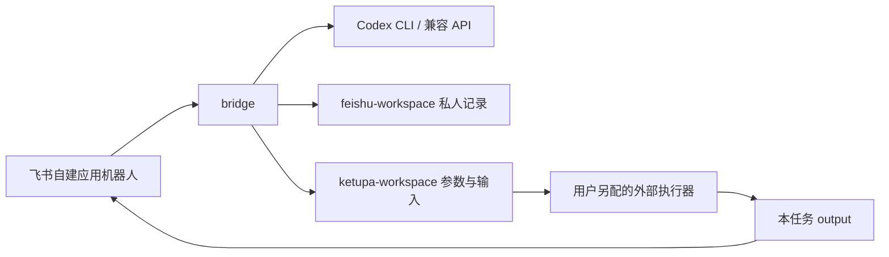

# Ketupa Agent Feishu Bridge

**Ketupa 智能体飞书桥接**：**连接模型、保存本地对话、交接外部任务**。不附带账号、聊天记录、模型权重、商业求解器或仿真核心。

建议 GitHub 仓库名：`ketupa-agent-feishu-bridge`。

## 三个模块

```text
bridge/               飞书长连接、权限检查、模型适配、命令入口
feishu-workspace/     飞书工作区：聊天、附件、会话状态
ketupa-workspace/     Ketupa 任务工作区：参数、独立工程、执行器交接
config/               配置模板；本机配置生成后禁止提交
docs/                 配置、AI 辅助配置、发布说明、作者信息
scripts/              发布检查和白名单打包
test/                 不使用真实账号的自动化测试
release/            最新压缩包与校验资料；自动生成，禁止提交 Git
```

| 配置字段          | 默认相对路径               | 保存内容                                                     |
| ----------------- | -------------------------- | ------------------------------------------------------------ |
| `workspace.local` | `feishu-workspace/runtime` | 飞书实际收到的授权对话、附件、模型上下文                     |
| `workspace.tasks` | `ketupa-workspace/runtime` | 每个提交独立的 input、cir、include、output、logs、状态与归档 |

两个 runtime 都是使用者的私有数据，不进入源码包。Ketupa 工作区只提供任务接口，不附带求解器、业务代码或已有工程。根目录仅保留 npm 必需的两个 JSON：`package.json` 和 `package-lock.json`。



## 快速开始

需要 Node.js 22.19+、自己创建的飞书应用及模型访问权限。运行前阅读 [逐步配置](docs/CONFIGURE.md)。

```sh
npm ci --ignore-scripts
npm run init
```

本机填写 `config/.env`，然后绑定自己的机器人私聊：

```sh
npm run pair
```

按终端提示，把一次性配对消息发给**新建的测试机器人**。配对只修改忽略上传的 `config/settings.local.json`。将 `model.sendChatToModel` 设为 `true` 表示允许相应对话文本发给模型；再运行：

```sh
npm run doctor
npm start
```

**配置关键词**：`配置飞书本机接口`。把 [AI_SETUP.md](docs/AI_SETUP.md) 的指令交给 AI，让它先读文档、验证本机配置。不要把密钥粘贴进聊天。

## 可用能力和边界

- 私聊与白名单群聊；同一聊天、同一发送者独立上下文。Codex 显式 resume 原 thread；兼容 API 使用有上限的文本历史。
- 服务运行后收到的授权附件直接存本地，不要求先上传云盘。不能绕过平台下载权限，也不会读取其他用户/其他应用历史。
- 上传 `.txt` 后执行 `/task demo example {}`，再 `/run 任务ID`、`/result 任务ID` 可验证接口流转。demo 输出明确标为演示，**不是仿真结果**。
- 真实执行器由用户固定配置；仅传 JSON 和输入文件，不从模型回答生成 shell。不配置执行器，就不会运行真实业务。
- 只有任务 `output/` 的文件可交付；输入、网表和日志留在本机。文件数量上限 20，每文件 32 MiB；需要压缩时由自己的执行器在 output 中生成 ZIP。
- 专业问答可检索逐文档授权的本地 Markdown/TXT；校验 SHA-256、用户与会话权限，只发有限片段。策略变化会清除旧模型上下文，普通聊天不依赖知识命中。[知识配置](docs/KNOWLEDGE.md)。
- `/plan 自然语言需求` 生成 schema 校验的预览，缺文件或参数时列出清单；`/submit 预览ID` 才建任务。[任务规划](docs/PLANNING.md)。模型不提供 shell 或执行器代码。
- `/run` 非阻塞进入有并发上限的后台队列；`/cancel` 取消，`/tasks` 查看，重启时将已中断任务标记为 interrupted，避免重复求解。[队列](docs/TASK_QUEUE.md)。
- `/reset` 清除模型上下文并保留本地审计；`/health` 查看本会话状态，`npm run status` 查看本机脱敏快照，区分配置型号与最近模型服务实际报告的型号。
- 不含 Aily 平台专属智能体额度、市场应用、跨租户分发、语音转写、流式卡片、桌面运维 EXE 或商业求解器。公开版通过自己的飞书机器人提供智能体工作接口，不会把 Aily 账号自动接管。

## 隐私与许可

作者：**Asenjo.HB.L**。联系邮箱：[asenjoaupa@gmail.com](mailto:asenjoaupa@gmail.com)、[3405802009@qq.com](mailto:3405802009@qq.com)。公开主页与联系说明见 [作者信息](docs/AUTHOR.md)。这些公开字段不属于使用者的运行配置。

源代码使用 **Apache-2.0**，见 [LICENSE](LICENSE)。依赖遵循各自许可。Apache-2.0 允许商用和修改，不要求公开独立的私有执行器；它不替代隐私隔离，也不会自动保护被误上传的工程。

仅从经过检查的干净源码包建立公开仓库。参见 [发布说明](docs/PUBLISH.md) 与 [安全边界](SECURITY.md)。

此项目是唯一发布入口。`npm run release:pack` 固定更新 `release/ketupa-agent-feishu-bridge.zip`，不累积版本包。完整检查范围、已修复风险与隔离要求见 [安全体检](docs/SECURITY_REVIEW.md)。

```sh
npm test
npm run release:check
npm run release:pack
```

测试使用模拟事件/模型，不消耗真实模型额度，不给真实账号发消息。平台登录、授权、网络和真实求解器需要使用者自行验收。

详细结构见 [架构](docs/ARCHITECTURE.md)，长期运行见 [运维手册](docs/OPERATIONS.md)，参考项目功能与源码筛查见 [对比说明](docs/COMPARISON.md)。包体按可审查的接口功能保持精简，不打包依赖或用素材凑体积。
