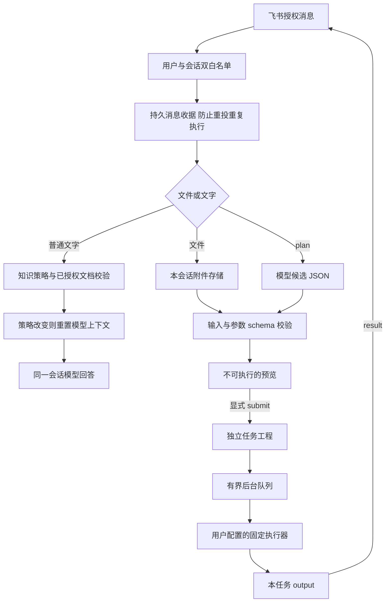

# 架构与模块边界

`ketupa-agent-feishu-bridge` 的公开版只提供三个模块。知识、附件、消息和任务的实际数据均放在使用者自己配置的 runtime 中，不随源码发布。

| 模块             | 文件                             | 职责                                                          |
| ---------------- | -------------------------------- | ------------------------------------------------------------- |
| bridge           | cli / config / platform          | 配置校验、飞书连接与凭证探测                                  |
| bridge           | service / commands / attachments | 会话串行处理、命令路由、附件落地、output 交付                 |
| bridge           | model / process / operations     | 模型适配、隐藏子进程、取消、实例互斥、脱敏状态                |
| feishu-workspace | files / store                    | 路径校验、原子 JSON、聊天审计、附件索引、上下文代次、消息收据 |
| feishu-workspace | knowledge                        | 逐文档授权、哈希校验、有限文本检索                            |
| ketupa-workspace | plans                            | 自然语言候选的校验、预览、一次性提交                          |
| ketupa-workspace | tasks / queue                    | 独立工程、输入完整性、队列、执行器交接、取消、恢复            |

## 消息与数据流

### 隔离粒度

会话键由 chat 和真实事件 sender 一起计算。相同群中的不同用户也不共享模型 thread、附件、预览或任务。群消息须 @ 当前机器人，授权群附件可不 @，前提是平台确实投递事件。普通用户消息中的“我是某人”不改变身份。

`workspace.local` 是飞书工作路径，存实际收到的消息与文件；`workspace.tasks` 是 Ketupa 任务路径，存选定的输入及工作产物。两者不可重叠或覆盖代码。外部执行器只收到当前任务 JSON 与受限环境，不继承飞书或模型密钥。

### 确定性与模型分工

模型只提出 `{workflow, caseName, params, files}`。程序验证注册流程、类型、枚举、范围和真实附件归属。文件或参数不明时，预览列出缺项；不会猜网表、层叠、网络或物理尺寸。即使模型要求执行命令，也没有对应的候选字段。

`/submit` 只是建工程；默认仍需 `/run`。设置 `tasks.autoRun=true` 后，显式 `/task` 或 `/submit` 建立的任务进入队列；普通聊天和 `/plan` 不直接运行任务。固定执行器负责跨字段物理约束、网表及求解结果验证，本接口不替代这些专业检查。

### 对话与知识

Codex 正常沿用原 thread；兼容 API 重发有数量和字符上限的历史。更换模型配置、撤回知识授权、文档字节改变或知识策略不可用，会开始新的上下文代次，保留审计但停止发送旧记录。显式 `/reset` 同样只清除模型上下文，不删除本地审计。

知识检索是词语匹配，不是全库预读、向量数据库或模型训练。没有命中时仍可依据通用知识作答并说明假设；不能编造本地证据。附件保存不表示其正文获准发给模型。

### 故障语义

消息处理前先写独占收据。崩溃或回包失败不会自动重放同一消息的副作用；用户可通过新消息 `/tasks`、`/files` 检查现状。此策略偏向避免重复执行，不承诺网络故障下每条回复必达。

预览提交和实际运行均有持久 claim。结果不确定时保留 claim，交由管理员核查，不用超时删除 claim 后重跑。成功退出码只代表固定执行器报告成功；不证明仿真 signoff 或物理正确。

Codex 的 read-only、提示词和候选 schema 不会撤销它已有的 MCP、插件或外部账号权限。必须配置独立且受限的运行账号及 Codex home；严禁复用带个人特权工具的环境。兼容 API 请求不提供 tools。详见 SECURITY.md。
